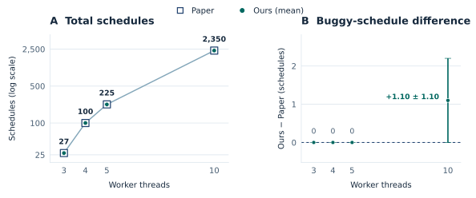

# PERIOD on SCTBench: Table 2 comparison

**Table. Paper vs. Ours for four CS.reorder benchmarks.**

| Worker threads | Paper: first bug | Ours: first bug (R1) | Paper: total | Ours: total (mean ± SD) | Paper: buggy | Ours: buggy (mean ± SD) |
| ---: | ---: | ---: | ---: | ---: | ---: | ---: |
| 3 | 6 | 6 | 27 | 27.00 ± 0.00 | 6 | 6.00 ± 0.00 |
| 4 | 9 | 9 | 100 | 100.00 ± 0.00 | 12 | 12.00 ± 0.00 |
| 5 | 12 | 12 | 225 | 225.00 ± 0.00 | 20 | 20.00 ± 0.00 |
| 10 | 27 | 27 | 2,350 | 2,350.00 ± 0.00 | 89 | 90.10 ± 1.10 |

Totals and buggy counts summarize 10 runs per benchmark. The first-bug ordinal is verified from the Round 1 full stdout for each benchmark, the only round with full stdout archived in this batch. All 40 runs had zero timeouts and driver exit code zero.

All 40 runs matched the paper's total schedule counts. Buggy counts matched in the 3-, 4-, and 5-thread benchmarks. At 10 threads, the paper reports 89 buggy schedules. Our mean was 90.10 ± 1.10, with a range of 89 to 93. The mean was 1.10 schedules (1.24%) above the paper value. This comparison covers four benchmarks in the PERIOD columns of Table 2.

Figure. PERIOD on four CS.reorder benchmarks from SCTBench. Panel A compares the paper's total schedule counts with the means of 10 runs per benchmark. The markers overlap because all totals match. Panel B shows the difference in buggy schedules (our mean minus the paper value). Error bars are ±1 sample standard deviation across 10 runs and are invisible where SD is zero.

Sources

- Wen et al., ICSE 2022, [Table 2, p. 9](https://wcventure.github.io/pdf/ICSE2022_PERIOD.pdf#page=9), PERIOD columns.
- [40 per-run records](https://github.com/kiritojie/cs340-period-replication/blob/60c6868aa527c9d7cb2b090bd618d2fffc80f722/docs/results/table2-reorder-schedules/rounds-summary.tsv) and [run evidence folders](https://github.com/kiritojie/cs340-period-replication/tree/60c6868aa527c9d7cb2b090bd618d2fffc80f722/docs/results/table2-reorder-schedules). Pinned commit: `60c6868aa527c9d7cb2b090bd618d2fffc80f722`.
- [3 threads, Round 1 first-error evidence](https://github.com/kiritojie/cs340-period-replication/blob/60c6868aa527c9d7cb2b090bd618d2fffc80f722/docs/results/table2-reorder-schedules/reorder_3/round-R1/stdout.log#L30-L31).
- [4 threads, Round 1 first-error evidence](https://github.com/kiritojie/cs340-period-replication/blob/60c6868aa527c9d7cb2b090bd618d2fffc80f722/docs/results/table2-reorder-schedules/reorder_4/round-R1/stdout.log#L33-L34).
- [5 threads, Round 1 first-error evidence](https://github.com/kiritojie/cs340-period-replication/blob/60c6868aa527c9d7cb2b090bd618d2fffc80f722/docs/results/table2-reorder-schedules/reorder_5/round-R1/stdout.log#L36-L37).
- [10 threads, Round 1 first-error evidence](https://github.com/kiritojie/cs340-period-replication/blob/60c6868aa527c9d7cb2b090bd618d2fffc80f722/docs/results/table2-reorder-schedules/reorder_10/round-R1/stdout.log#L51-L52).

**Contribution.** Li Zhijie cross-checked the team's archived results against the paper, recalculated the statistics, and prepared this table and figure with ChatGPT assistance. The [experiment report](../../table2-segment1-reorder.md) documents how the team ran the benchmarks.
