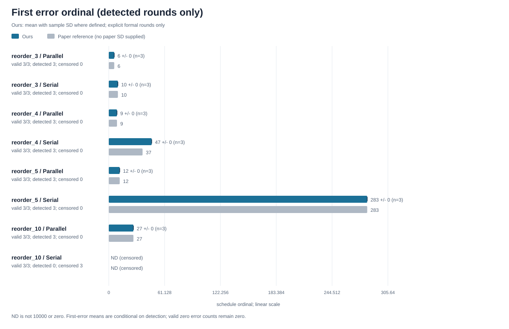
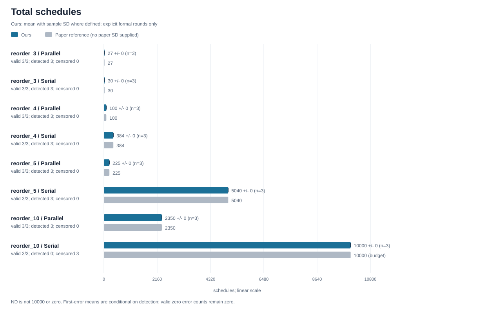
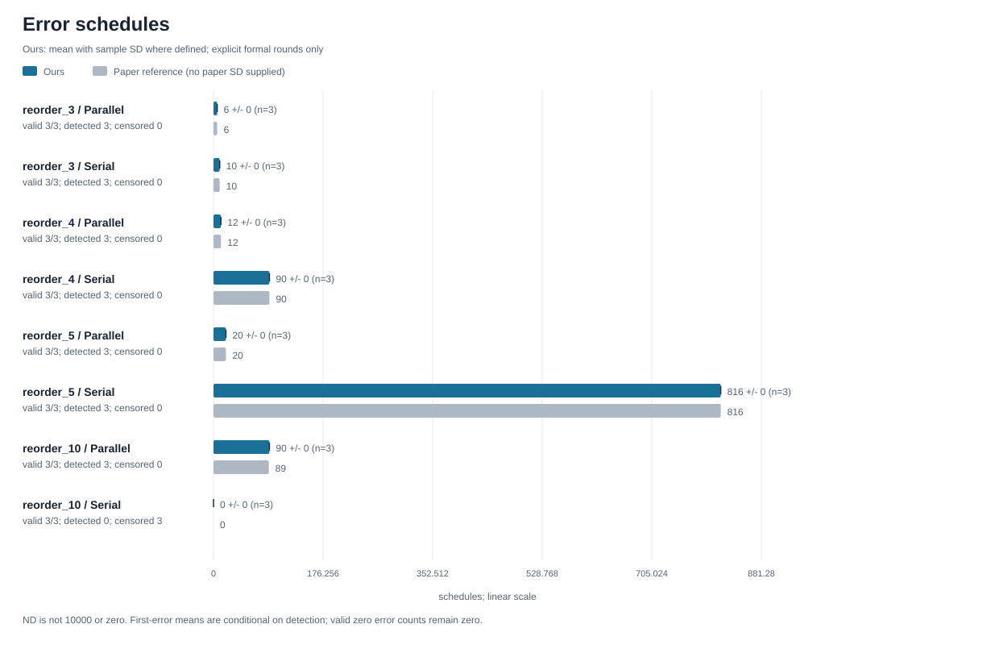
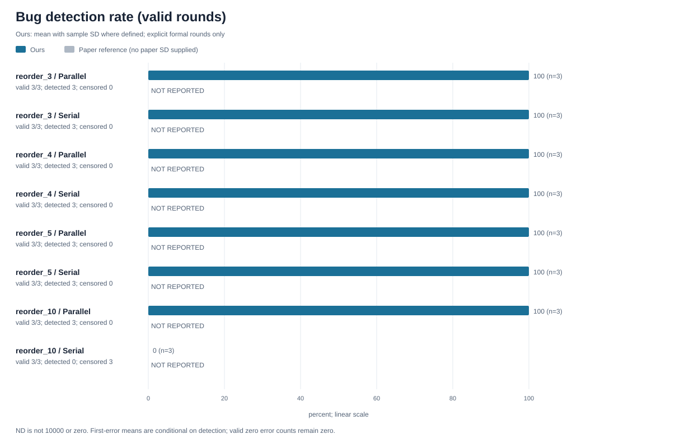
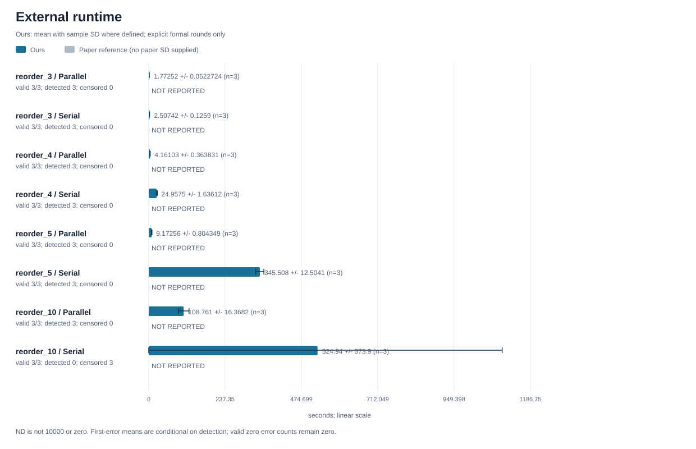

# Table 2 / RQ1 batch result

Final status: **MINIMUM_24_PASSED**

Session: `/mnt/e/cs340-period-replication/docs/results/table2-rq1-recovered-session-20261124T180224Z-210n7nbf`

Minimum required: 24 valid formal rounds. Verified valid rounds: **24 / 24**.

| Benchmark | Status | Reason |
| --- | --- | --- |
| reorder_3_bad | REUSED_FROZEN_SIX | verified immutable six-round evidence; no launch |
| reorder_4_bad | REUSED_COMPLETED | retained accepted cohort; no new execution |
| reorder_5_bad | REUSED_COMPLETED | retained accepted cohort; no new execution |
| reorder_10_bad | FORMAL_COMPLETE |  |

Statistics and original paper comparison are generated by the unchanged report writer:

- [Mean and SD / per-group statistics](statistics/group-statistics.csv)
- [Paper vs. Ours](statistics/paper-vs-ours.md)
- [Per-round results](statistics/per-round.csv)
- [Detailed statistical report and limitations](statistics/report.md)
- [Censored observations](statistics/censored.csv)
- [Invalid attempts](statistics/anomalies.csv)

The sample SD uses n-1. First-error means include detected valid rounds only. ND is not 10000.
Missing products use the official three-step build in new directories, with preserved toolchain/runtime identities, exclusive publication and measured ABI acceptance.
No replacement attempts or extra repetitions are selected.
Only explicit formal observations enter statistics; historical A0, pilot and adaptation records remain separate.
CPU affinity remains 0-31. Hardware, supervision overhead, three repetitions and the workload family limit comparison with the full paper.
A benchmark-local failure preserves prior accepted rounds. An unknown, environment or integrity failure stops subsequent execution.

Accepted completed cohorts are reused without target execution. Only unfinished programs are eligible for new formal rounds.

[Build plan and immutable six-round reference](plan.json)

## Comparison charts

[All charts and exact chart data](charts/README.md)

The first-error mean is conditional on detection; ND/censoring and sample counts must be read alongside it.
Differences from the paper are retained. Parallel final-period execution can depend on host scheduling; matching schedules do not guarantee matching outcomes.
Build directories can change DWARF and binary hashes; every new binary is treated as a new measured identity, using the same verified runtime object.
