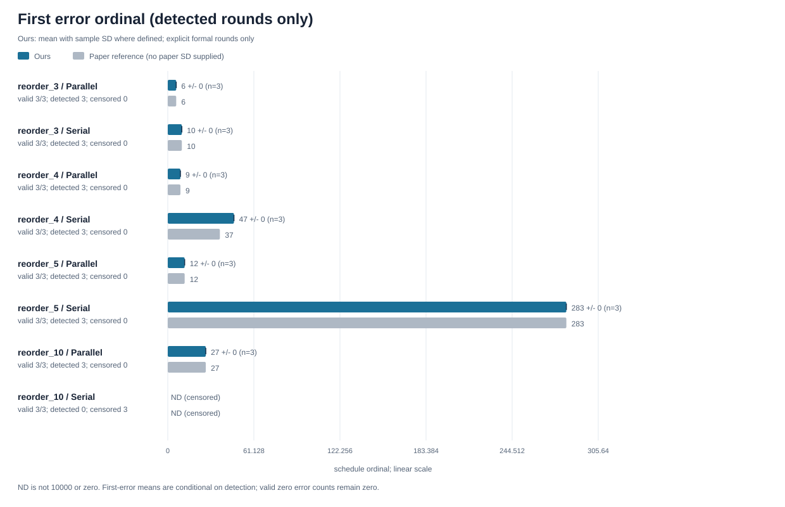
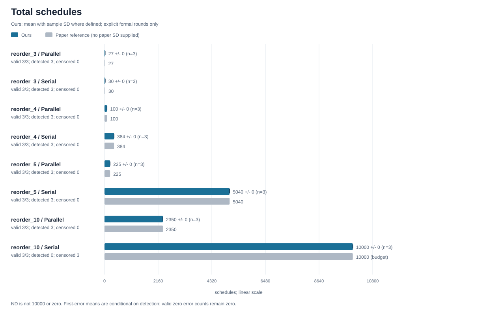
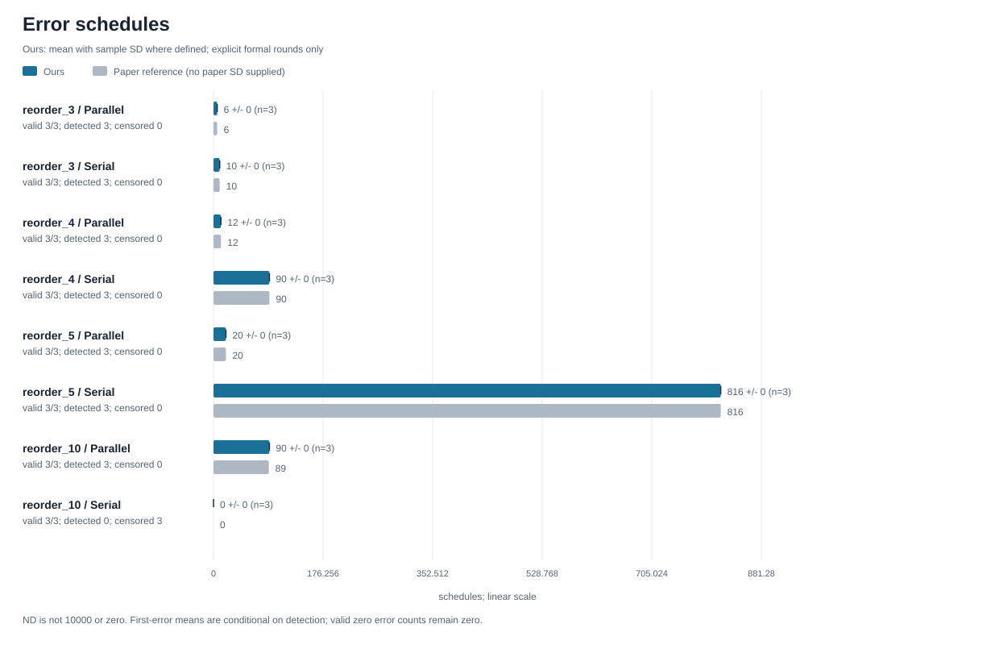
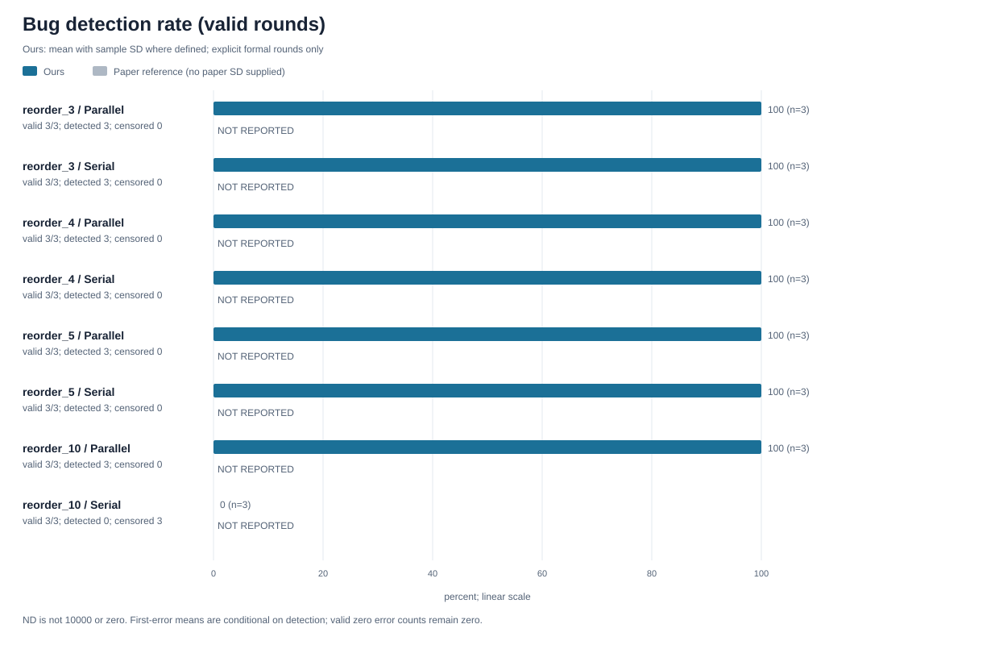
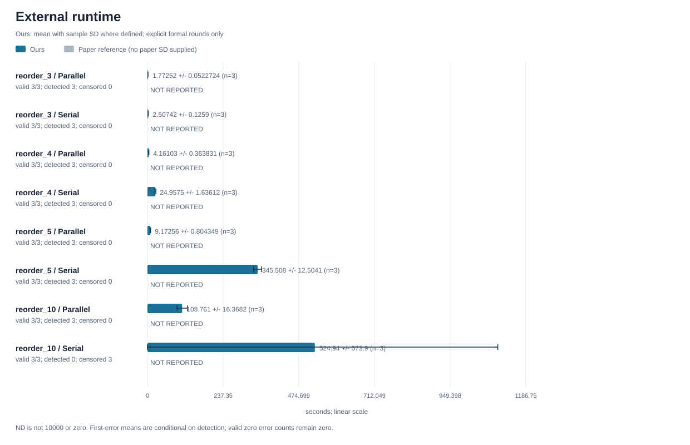

# RQ1 comparison charts

The CSV contains the exact source values; SVG labels are rounded for readability.

Missing runs, invalid-only groups and ND are separate labels. They are never inserted as numeric zero or 10000.
Paper references come from the existing frozen report; paper SD, detection rate and runtime are not invented.
External runtime includes local profiling and supervision overhead; it is not a direct paper timing comparison.

## First error ordinal (detected rounds only)

## Total schedules

## Error schedules

## Bug detection rate (valid rounds)

## External runtime

